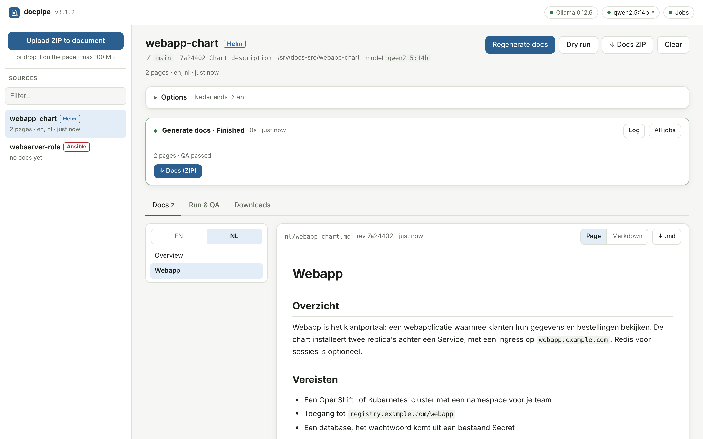
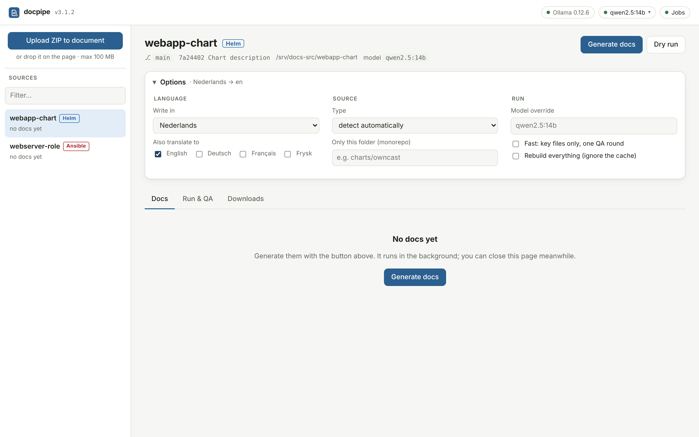
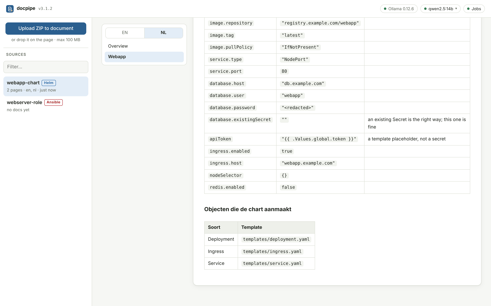
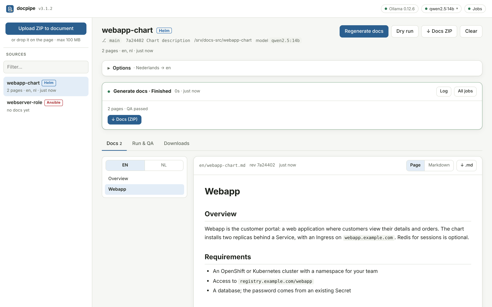
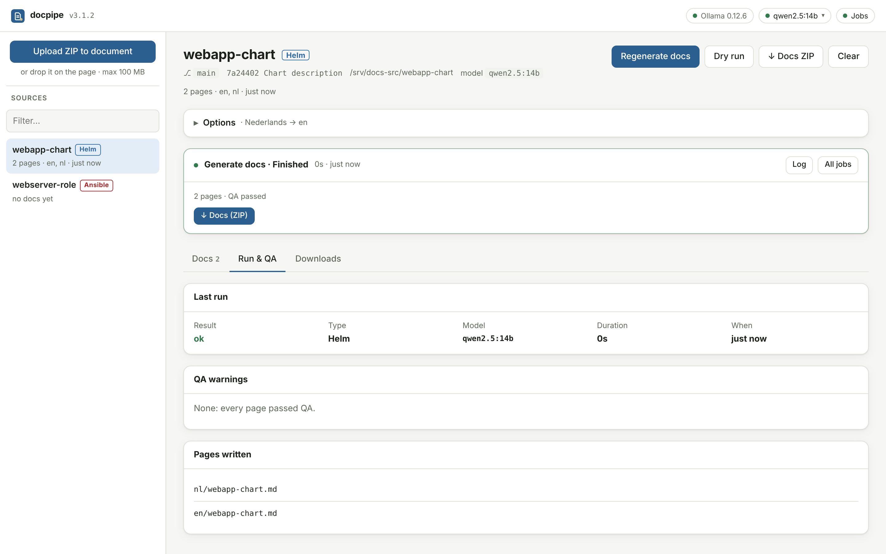

# docpipe v3

[](https://github.com/jwklijnsma/docpipe/actions/workflows/docker.yml)
[](https://jwklijnsma.github.io/docpipe/)

Generates user-facing documentation from **Helm charts, Kubernetes/Kustomize
manifests, Argo CD GitOps repos, Ansible playbooks** and ordinary Git repos, with
a pipeline of LLM agents on your own Ollama server. Writes **Dutch** (or any
language) directly, builds an **MkDocs site**, and delivers everything as a
**GitLab merge request** in your docs repository.

📖 **Documentation: <https://jwklijnsma.github.io/docpipe/>**

```
source ─▶ scan + redact secrets ─▶ cache? ─▶ extract facts ─▶ select ─▶ write (nl)
       ─▶ QA/fix ─▶ translate (en…) ─▶ QA/fix ─▶ pages + reference tables
       ─▶ index + mkdocs.yml ─▶ docs repo branch ─▶ merge request
```



## Features

- **Five source types**, detected automatically: `helm`, `k8s`, `argocd`, `ansible`,
  `git`/`local`. Reference tables (Helm values, Kubernetes resources, Ansible variables) are
  rendered in code, not by the model, so no made-up defaults.
- **Dutch first**: B1 level, je- or u-vorm, your glossary, and a per-section check for
  paragraphs left in English. Translations to other languages get their own QA.
- **MkDocs site**: front matter, index pages per language and `mkdocs.yml`, with a language
  switcher for several languages. Hand-written pages are never overwritten.
- **GitOps delivery**: one rolling merge request in your docs repo, with changed pages,
  source revisions and QA warnings. `watch` rebuilds only sources whose projects changed.
- **Previews on merge requests**: `docpipe mr` comments the new page and the changed table
  rows on open merge requests of the source projects.
- **Web UI** (`docpipe serve`): generate, read and download docs in the browser, with a job
  queue on the server.
- **Secrets are redacted** before anything reaches the model.

<details>
<summary>More screenshots</summary>

| | |
|---|---|
|  |  |
| Write in Dutch, also translate to English | The values table from values.yaml, rendered in code; the password is redacted |
|  |  |
| The same page in English | The last run: QA warnings and pages written |

</details>

## Quick start

No install needed, only `requests` and `pyyaml`:

```bash
python3 orchestrator.py init                          # creates config.yaml
#  -> set llm.endpoints to your Ollama server in config.yaml
python3 orchestrator.py check                         # is the Ollama server ready?
python3 orchestrator.py ./charts/owncast              # document a folder
python3 orchestrator.py ./my-role --lang en --fast    # translate too, fewer LLM calls
```

Pages land in `output/docs/<language>/`, with `output/mkdocs.yml` for a preview
(`cd output && mkdocs serve`).

Or installed:

```bash
pip install .
docpipe --ollama http://ollama.example.internal:11434 check
docpipe --ollama http://ollama.example.internal:11434 run --dir ./charts/owncast --primary-lang nl
docpipe --ollama http://ollama.example.internal:11434 serve --root ~/git --open   # web UI
```

For regular use: `cp config.example.yaml config.yaml`, fill in sources, then
`docpipe run --publish` (or `docpipe watch --publish` nightly).

## Commands

| Command | |
|---|---|
| `docpipe run [--source N…] [--dir P \| --url U] [--subdir S]` | generate |
| `  --primary-lang nl --lang en` | write in Dutch, translate to English |
| `  --fast` / `--force` / `--dry-run` / `--publish` | speed / ignore cache / no LLM calls / open MR |
| `docpipe check` | endpoints, models, tok/s, % of model in VRAM |
| `docpipe watch [--publish]` | rebuild sources whose GitLab projects changed |
| `docpipe mr [--interval N]` | docs preview as a comment on open merge requests |
| `docpipe site` | (re)write index pages + mkdocs.yml locally |
| `docpipe publish [--dry-run]` | push to docs repo, open/update MR |
| `docpipe serve [--root DIR…]` | web UI (port 8770): generate, read and download docs |

Exit codes: `0` ok · `1` a source failed, has open QA issues, or publish failed · `2` config/usage · `3` Ollama not usable.

## Documentation

| | |
|---|---|
| [Install](https://jwklijnsma.github.io/docpipe/getting-started/install/) · [Quick start](https://jwklijnsma.github.io/docpipe/getting-started/quickstart/) | `orchestrator.py`, pip, container |
| [Generate docs](https://jwklijnsma.github.io/docpipe/usage/run/) · [Source types](https://jwklijnsma.github.io/docpipe/usage/sources/) · [Languages](https://jwklijnsma.github.io/docpipe/usage/languages/) | Options, cache, QA; what each type gets; Dutch |
| [MkDocs site](https://jwklijnsma.github.io/docpipe/usage/site/) · [Publish](https://jwklijnsma.github.io/docpipe/usage/publish/) · [MR previews](https://jwklijnsma.github.io/docpipe/usage/mr-previews/) | Site, GitOps delivery and `watch`, previews |
| [Web UI](https://jwklijnsma.github.io/docpipe/usage/web-ui/) | Generate, read and download in the browser |
| [Container and systemd](https://jwklijnsma.github.io/docpipe/deploy/container/) · [Scheduled runs](https://jwklijnsma.github.io/docpipe/deploy/scheduled/) | `install.sh`, OpenShift CronJob, systemd timer, docs-repo CI |
| [Speed and tuning](https://jwklijnsma.github.io/docpipe/speed/) · [Troubleshooting](https://jwklijnsma.github.io/docpipe/troubleshooting/) | `check`, context buckets, common problems |
| [Configuration](https://jwklijnsma.github.io/docpipe/reference/configuration/) · [Commands](https://jwklijnsma.github.io/docpipe/reference/cli/) · [Security](https://jwklijnsma.github.io/docpipe/reference/security/) | Every key and flag; redaction and tokens |
| [Contributing](https://jwklijnsma.github.io/docpipe/development/contributing/) · [Releasing](https://jwklijnsma.github.io/docpipe/development/releasing/) | Tests, web UI build, docs, releases |

The site is built from [`documentation/`](documentation/) with [Zensical](https://zensical.org):
`pip install -r requirements-docs.txt && zensical serve`. (`docs/` is docpipe's own default
output folder, so the site's pages live in `documentation/`.)

## Development

```bash
pip install -e '.[test]' mkdocs-material mkdocs-static-i18n && pytest
```

The tests run against an in-process fake Ollama and fake GitLab API, including a
real `mkdocs build --strict` of a bilingual site, the full merge-request flow
against a local bare repository, and the web UI end to end. `python3 tests/serve_fake_ollama.py`
starts that fake Ollama on its own, to try the web UI without a GPU.
