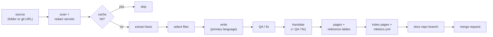

# docpipe

**User-facing documentation, written from your repositories by LLM agents on
your own Ollama server.** docpipe reads Helm charts, Kubernetes/Kustomize
manifests, Argo CD GitOps repos, Ansible playbooks and ordinary Git repos,
writes **Dutch** (or any language) directly, builds an **MkDocs site**, and
delivers everything as a **GitLab merge request** in your docs repository.

No code leaves your network, and secrets are redacted before anything reaches
the model.

-   :material-rocket-launch: **[Quick start](getting-started/quickstart.md)**

    Point it at an Ollama server and a folder. No install needed with `orchestrator.py`.

-   :material-translate: **[Dutch and other languages](usage/languages.md)**

    Writes in Dutch from the start, B1 level, je- or u-vorm, your glossary, and
    a check for paragraphs left in English.

-   :material-source-merge: **[Publish as a merge request](usage/publish.md)**

    One rolling merge request in your docs repo, with a table of changed pages
    and QA warnings.

-   :material-eye: **[Previews on merge requests](usage/mr-previews.md)**

    A docs preview as a comment on open merge requests of the source projects,
    before anything is published.

## The pipeline

Each step is an agent in `docpipe/`:

| Step | What it does | Code |
|---|---|---|
| check | Ollama reachable, model installed | `llm.py` |
| scan | Clone or read the source, redact secrets | `scan.py` |
| facts | Values, routes, images, environments | `facts.py` |
| select | Pick the files that matter | `selector.py` |
| write | The article, in your language | `generate.py` |
| qa/fix | Check and repair the article | `qa.py` |
| translate | Other languages, with their own QA/fix | `translate.py` |
| site | Index pages and `mkdocs.yml` | `site.py` |
| publish | Merge request in the docs repo (optional) | `publish.py` |

The reference tables (Helm values, Kubernetes resources, Ansible variables) are
**rendered in code, not by the model**: no made-up defaults, no tokens spent
re-typing tables, and they appear in every language.

## Ways to run it

| How | Where it's described |
|---|---|
| `python3 orchestrator.py` without installing | [Quick start](getting-started/quickstart.md) |
| `docpipe run` for one folder or every configured source | [Generate docs](usage/run.md) |
| Web UI: generate, read and download docs in the browser | [Web UI](usage/web-ui.md) |
| Container and Podman service | [Container and systemd](deploy/container.md) |
| Nightly `watch --publish` (OpenShift CronJob, systemd timer) | [Scheduled runs](deploy/scheduled.md) |
| Previews on merge requests | [Previews on merge requests](usage/mr-previews.md) |

!!! tip "Sibling projects"
    [ansreview](https://jwklijnsma.github.io/ansreview/) and
    [helmreview](https://jwklijnsma.github.io/helmreview/) review the same kind of
    repositories with the same Ollama server.
