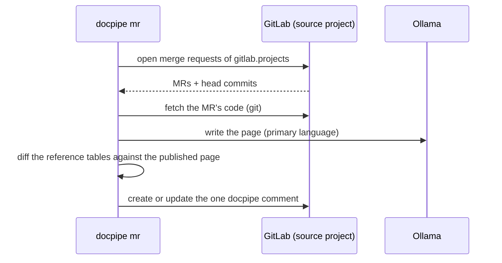

# Previews on merge requests

`docpipe mr` looks at the open merge requests of the projects under
`gitlab.projects`. For each new commit it writes the page from the merge
request's own code and keeps **one comment** on the merge request up to date:

- the rows that change in the reference tables (values, resources, variables),
  compared with the published page;
- the whole new page, folded, to read before merging;
- QA warnings under **Needs attention**.

Nothing is published and your output folder is not touched: previews are built
under `state_dir/mr/`. After the merge, `watch --publish` delivers the real page
as before.



## Run it

```bash
docpipe mr --dry-run          # which merge requests would get a preview
docpipe mr --fast             # one round, then exit (timer, CronJob)
docpipe mr --interval 300     # keep running, look every 5 minutes
docpipe mr --force            # preview again, also commits already done
```

## Good to know

- **Polling, not a webhook.** Only outgoing calls to GitLab are needed.
- **Sources need a `url`.** A local `path` has no merge requests. With a
  `subdir`, only merge requests that touch that folder get a preview.
- **Once per commit.** Each commit is previewed once, and only in the language
  the pages are written in. A commit that fails is tried three times.
- **Token.** `GITLAB_TOKEN` needs the `api` scope on the source projects to
  comment.
- **Which MRs.** `gitlab.mr_skip_drafts` leaves drafts alone;
  `gitlab.mr_max_age_days` (14) skips merge requests nobody touched for that
  long (`0` = all).

## As a service

`deploy/docpipe-mr.service` runs `docpipe mr --fast --interval 300` as a
systemd service. See [Scheduled runs](../deploy/scheduled.md#previews-as-a-service).

## As a scheduled pipeline

`deploy/docs-repo.gitlab-ci.yml` has a `docpipe-mr` job for a pipeline schedule
in the docs repo (**Build › Pipeline schedules**, e.g. `*/15 * * * *`). Commit a
`docpipe.yaml` next to it with at least:

```yaml
llm:      {endpoints: [http://ollama.example.internal:11434]}
pipeline: {output_dir: docs, state_dir: .docpipe-state}   # docs/ = the published pages,
gitlab:   {url: https://gitlab.example.nl,                # the baseline for the table diff
           projects: [{path: platform/charts, source: owncast}]}
sources:  [...]                                           # each with a url
```

CI/CD variables: `GITLAB_TOKEN` (masked; `api` on the source projects) and
`DOCPIPE_GIT_TOKEN` (masked; `read_repository` on private source repos).
