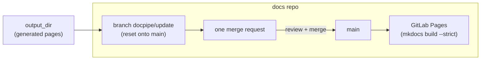

# Publish as a merge request

`docpipe publish` (or `run --publish`, `watch --publish`, or
`publish.enabled: true`) delivers the pages GitOps-style: as **one rolling
merge request** in your docs repository.



## What it does

1. Clones the docs repo and resets the rolling branch `docpipe/update` onto `main`.
2. Copies only docpipe-generated pages; hand-written pages are never touched.
3. Regenerates the index pages and `mkdocs.yml` across everything in the repo.
4. Commits, and skips the push if the branch already has exactly this content.
5. Force-pushes and **creates or updates one merge request**, with a table of
   changed pages, source revisions, QA warnings under **Needs attention**, and a
   review checklist. Labels and reviewers come from the config.

`publish --dry-run` prepares the commit and prints the MR description without
pushing.

!!! warning "Fix content at the source"
    Fix content in the source repos or the config, not on the MR branch: the
    branch is rebuilt every run.

## Configuration

```yaml
publish:
  enabled: false                      # true = publish after every run / watch
  repo: https://gitlab.example.nl/platform/docs.git
  # project: platform/docs            # derived from repo when unset
  token_env: GITLAB_TOKEN             # api + write_repository scope
  base_branch: main
  branch: docpipe/update              # rolling MR branch, rebuilt every run
  target_dir: docs
  labels: [documentation, docpipe]
  reviewer_ids: []                    # GitLab user ids
  prune: false                        # remove pages of sources no longer configured
```

All keys are listed under [Configuration](../reference/configuration.md#publish).

## Tokens

| Variable | Scope | For |
|---|---|---|
| `GITLAB_TOKEN` | `api` + `write_repository` on the docs repo; `read_api` for `watch` | Pushing the branch and opening the MR |
| `DOCPIPE_GIT_TOKEN` | `read_repository` on private source repos | Cloning sources |

## Only what changed: watch

```bash
docpipe watch --dry-run     # only list what would be rebuilt
docpipe watch --publish     # rebuild changed sources, then publish
```

`watch` asks GitLab which projects under `gitlab.projects` got commits on the
watched `branches` since the last **successful** run, and rebuilds only the
matching sources. On the first run it looks back `lookback_hours` (24). A failed
night doesn't lose changes: they are picked up the next time.

```yaml
gitlab:
  enabled: true
  url: https://gitlab.example.nl
  token_env: GITLAB_TOKEN
  branches: [master, main]
  projects:
    - {path: platform/charts, source: owncast}
    - {path: team-shop/webshop-deploy, source: webshop}
```

Run it nightly: see [Scheduled runs](../deploy/scheduled.md).
